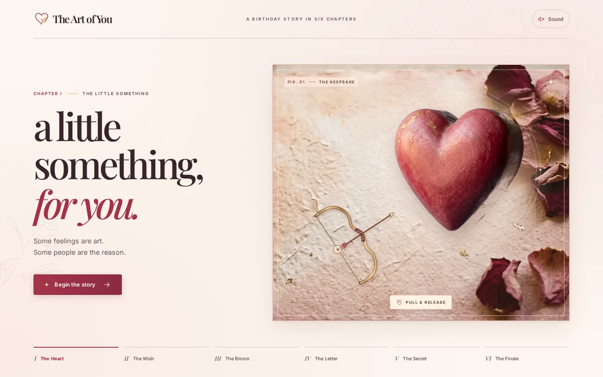

<p align="center"></p>
<h1 align="center">The Art of You</h1>
<p align="center"><em>Some feelings are art. Some people are the reason.</em></p>
<p align="center">A small, interactive birthday keepsake told in six illustrated chapters.</p>



**Pages address:** [atikulislamx.github.io/The-Art-of-You](https://atikulislamx.github.io/The-Art-of-You/) (available after the first successful Pages deployment).

## Turn the pages

| Chapter | What happens |
| :--- | :--- |
| **I. The Heart** | Pull back the illustrated bowstring and let go. The wax heart dissolves into rose and champagne particles. A button offers an alternative to dragging. |
| **II. The Wish** | A birthday wish appears in stages against a dark velvet and rose-petal backdrop. |
| **III. The Bloom** | Canvas draws a tree branch by branch, then opens its flowers into a loose heart-shaped canopy. |
| **IV. The Letter** | Read a personal letter on textured stationery with a handwritten signature. |
| **V. The Secret** | Break a wax seal to uncover one last wish. |
| **VI. The Finale** | Linger in the garden, share the keepsake, or replay from the beginning. |

Sound starts only after the first arrow release or an explicit press of the **Sound** button. The original ambient score is optional throughout. Visited chapters can be reopened from the chapter rail. Keyboard controls and reduced-motion support are built in.

## Run locally

The site is static: HTML, CSS, vanilla JavaScript modules, Canvas 2D and SVG, with self-hosted Playfair Display, Great Vibes and Inter. There are no third-party runtime requests or dependencies. Use Node.js 20+ for the local server and tooling.

```sh
npm run dev       # http://localhost:4173
npm test          # No install needed for the unit tests
npm run build     # Outputs the publishable static files in dist/
```

Optional browser checks: run `npm ci` and `npx playwright install chromium`, keep `npm run dev` running, then use `npm run test:browser`. The suite walks the whole story at all six target sizes, including drag, touch, keyboard, and reduced-motion checks.

## Make it personal

Edit [`js/config.js`](js/config.js) for the recipient, date, letter, signature, hidden wish, audio and pacing. Read the [customization guide](docs/customization.md) before publishing personal details.

```text
index.html   Six chapters, site controls and sharing metadata
css/         Type, layouts, atmosphere and reduced-motion styles
js/          Configuration, scene controller, interactions and Canvas artwork
assets/      Artwork, icons, self-hosted fonts and the original score
scripts/     Local server, publish build and reproducible brand/score tooling
tests/       Unit and browser regression checks
docs/        Customization, deployment and asset notes
.github/     GitHub Pages workflow
```

## Publish to GitHub Pages

In **Settings → Pages → Build and deployment**, select **GitHub Actions** as the source. The workflow verifies pull requests targeting `main` and deploys from `main` once enabled. See the [deployment guide](docs/deployment.md) for a custom domain and preview checks.

For the repository’s own sharing image, upload [`assets/images/github-social-preview.png`](assets/images/github-social-preview.png) under **Settings → General → Social preview**. The website has a separate [Open Graph card](assets/images/social-preview.png). See the [asset notes](docs/assets.md) for provenance and font licenses.
